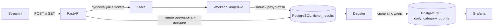

# Card Queue

Card Queue предлагает очередь поддержки по короткому обращению о банковской карте на английском. Сотрудник видит, куда направить обращение, и тратит меньше времени на ручную сортировку. По истории можно посмотреть, с какими проблемами клиенты обращались чаще.

## Запуск

Из корня проекта запустите все сервисы одной командой.

```bash
docker compose up --build
```

| Сервис | Адрес |
| --- | --- |
| Streamlit | [localhost:8501](http://localhost:8501) |
| Swagger | [localhost:8000/docs](http://localhost:8000/docs) |
| Dagster | [localhost:3000](http://localhost:3000) |
| Grafana | [localhost:3001](http://localhost:3001/d/card-queue/card-queue) (`admin` / `admin`) |

## Схема



`POST /tickets` возвращает `202` и `ticket_id` после подтверждения от Kafka. Пока результата нет в базе, `GET /tickets/{ticket_id}` отвечает `404`. Worker сначала сохраняет результат и только потом фиксирует смещение Kafka. Повторная обработка того же `ticket_id` оставляет одну запись в базе. `GET /tickets` возвращает последние 200 готовых результатов.

## Данные и модель

Из BANKING77 взяли категории `card_arrival`, `lost_or_stolen_card`, `card_swallowed`, `declined_card_payment` и `card_payment_not_recognised`. В `data/` лежат два исходных разбиения после фильтрации строк по категориям. Сохранили текст и метку. Получилось 617 строк для обучения и 200 для проверки.

Модель использует TF-IDF по словам и биграммам и логистическую регрессию. **Macro-F1 на тесте — 0,9553.** Модель обучается при сборке образа worker. Чтобы повторить замер, выполните `docker compose run --rm --no-deps worker python train.py` после сборки.

В локальном замере 4 параллельных клиента обработали 20 заявок за 0,23 с, около 86 заявок/с. Замеряли время от отправки `POST /tickets` до получения всех результатов через `GET /tickets/{ticket_id}`.

Данные BANKING77 опубликованы PolyAI под CC BY 4.0. Авторы описали датасет в работе *Efficient Intent Detection with Dual Sentence Encoders* (Casanueva и соавт., 2020). [Репозиторий датасета](https://github.com/PolyAI-LDN/task-specific-datasets/tree/master/banking_data) · [Лицензия](https://github.com/PolyAI-LDN/task-specific-datasets/blob/master/LICENSE) · [Статья](https://aclanthology.org/2020.nlp4convai-1.5/)

## Демо

1. В Streamlit отправьте `The ATM kept my card`. Сначала появится `Processing`, затем прогноз `Card retained by ATM` и строка в истории.
2. Поменяйте фильтр по очереди или датам. Таблица и оба графика используют одну и ту же выборку. Кнопка `Swagger API` открывает описание запросов.
3. Dagster пересчитывает дневные количества раз в минуту по UTC. Для запуска вручную откройте `refresh_daily_counts`, перейдите в `Launchpad` и нажмите `Launch Run`. После запуска обновите дашборд `Card Queue` в Grafana.

Краткое описание проекта — [one-pager.pdf](one-pager.pdf). Редактируемый исходник — [one-pager.md](one-pager.md).
